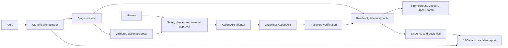

# Incident Zero — Design Guide

**Team 6 · 23 October 2026 · Design only; implementation has not started.**

Build one Python 3.11 command-line application in `incident-agent/`, alongside
the unchanged OpenTelemetry Demo. Use Pydantic for validation, httpx for HTTP,
pytest for tests, and an adapter for the organiser's LLM. Keep evidence and
audit records in local files. No new web service, database, agent framework,
or Kubernetes setup is needed for the first version.

## One-page architecture

| Area | Responsibility |
| --- | --- |
| Orchestrator | Own incident state, deadlines, evidence and final reporting. Run one incident and at most one forward remediation at a time. |
| Telemetry tools | Validate service/time filters; query bounded metrics, logs and traces; derive health from available telemetry. |
| Diagnosis | Choose the next read-only tool from current evidence, compare hypotheses, and return a validated diagnosis or uncertainty. |
| Safety and actions | Check the runbook allowlist, exact parameters, approval, expiry and kill switch before dispatch through the Action API. |
| Verification and reporting | Compare fresh post-action signals with the baseline; report recovery, failure or uncertainty with evidence. |

## Workflow

`RECEIVED → INVESTIGATING → DIAGNOSED → ACTION_PROPOSED → AWAITING_APPROVAL
→ APPROVED → EXECUTING → VERIFYING → RECOVERED`

Insufficient evidence becomes `INCONCLUSIVE → ESCALATED`; rejected approval
becomes `REJECTED → ESCALATED`. Unsupported actions, timeouts, cancellation,
kill-switch activation and failed or inconclusive verification also escalate.
Every terminal outcome produces a report. Dry-run stops before dispatch and
records an unexecuted proposal; it cannot claim recovery from a remediation.

## Shared internal records

These are proposed Python data contracts, **not the official report schema**.
Use UTC timestamps, stable IDs and validated enumerations throughout.

| Record | Minimum fields |
| --- | --- |
| Incident | ID, source, symptom, affected service if known, detection time, observation window, recovery condition. |
| Tool result / evidence | Status (`ok`, `empty`, `unavailable`, `error`), evidence ID, source, service, event/window time, collection time, tool/query, observed value or excerpt, trace/log ID if available, local capture reference. |
| Diagnosis | Suspected component/cause, supporting and conflicting evidence IDs, alternatives, uncertainty, confidence label, next step. |
| Action proposal | Incident ID, revision, runbook ID, action, exact target/arguments, reason, risk, expected effect and verification plan. |
| Approval / execution | Proposal digest, decision, approver, expiry, single-use status; request ID, dispatch time, response and known/unknown execution outcome. |
| Verification / report | Baseline and post-action evidence IDs, pass/fail/inconclusive result, timeline, final status and limitations. |

## Non-negotiable boundaries

- The LLM receives only registered read-only tools. It cannot execute shell
  commands, select arbitrary URLs, access the Docker socket or invoke actions.
  Treat logs and other tool content as untrusted data, never instructions.
- Diagnose from telemetry. Do not read feature-flag state, fault configuration,
  hidden incidents or scoring answers. Keep demo code and configuration unchanged.
- A human approves the exact proposal. Missing, expired, changed or replayed
  approval prevents execution. Recheck safety immediately before dispatch.
- Persist intent before dispatch. Never retry an action with an unknown outcome
  unless the official API provides safe reconciliation/idempotency semantics.
  A rollback also needs an approved runbook and explicit approval.
- Dry-run makes no mutations. The kill switch prevents new dispatches; it does
  not reverse an in-flight request. API success is not proof of recovery.
- Confidence is an uncalibrated estimate until measured. Missing telemetry,
  weak evidence or unavailable contracts lead to an honest escalation.

Use the [implementation guide](IMPLEMENTATION_GUIDE.md) for repository facts,
ownership, the five build steps and acceptance checks.
