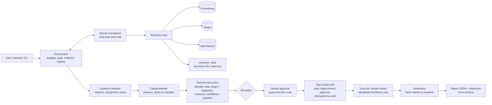

# Incident Zero: architecture overview (one page, as built)

**Team 6.** A Python 3.11 CLI agent in `incident-agent/` beside the OpenTelemetry Demo, plus our **team-defined
Action API**: a separate local process and the only component that can change the system. No organiser Action API
or report schema was supplied, so both are team-defined.

## Components

| Component | File(s) | Role |
| --- | --- | --- |
| CLI and orchestrator | `cli.py`, `orchestrator.py` | One incident at a time: state, budgets, tool dispatch, evidence registry |
| Investigator (LLM) | `reasoning.py` | Claude with tool calling. Tool results are wrapped as untrusted data. |
| Telemetry tools | `telemetry.py`, `resources.py`, `state_tool.py` | Fixed query templates, validated service names, windows of at most 60 min, evidence saved to disk |
| Evidence validator | `guardrails.py` | Checks each diagnosis against the captured evidence |
| Planner (LLM) | `remediation.py` | One `propose_action` or `escalate`. It cannot execute. |
| Policy and approval | `safety.py`, `response.py` | Deterministic checks, kill switch, approval prompt, single dispatch, audit journal |
| Action API | `action_server.py`, `action_executor.py`, `action_api_client.py` | Separate process. Bearer auth, server-issued approval code, `docker restart` |
| Verification | `verify.py` | Per-check comparison with the baseline, with a minimum-traffic guard |
| Reports | `report.py`, `report_io.py` | Markdown plus JSON validated against `schemas/incident_report.schema.json` |

## Tools the agent uses (all read-only)

| Tool | What it does |
| --- | --- |
| `overview` | Request rate, error rate and p95 for every service |
| `resource_overview` | Fleet CPU, memory, restarts, and containers that stopped reporting |
| `query_metrics` | One of 10 fixed metrics for one service |
| `service_health` | Combined health view of one service |
| `search_traces` | Error traces, error origin and observed caller → callee edges |
| `query_logs` | Recent logs at or above a severity (WARN by default) |
| `container_state` | Live Docker state via the Action API's `GET /v1/services`. Offered only when the API is configured and reachable. |

The model never sees feature-flag state, fault configuration or evaluator data.

## How it decides

1. **Bounded loop:** 6 model calls, 12 tool calls, 180 s and 60k tokens, plus one output repair.
2. **Investigate:** survey the fleet, follow up flagged services, and trace error chains to the deepest failing
   service. Compare application and infrastructure hypotheses.
3. **Diagnose or abstain:** the diagnosis must cite evidence IDs.
4. **Validate the diagnosis:**
   - every cited ID must exist on disk;
   - at least one supporting item must be `ok`;
   - the component must appear in the cited evidence.

   A failing diagnosis gets one bounded correction, then becomes `INCONCLUSIVE`. Code caps `high` confidence to
   `medium` unless 2 or more sources support it. An unexamined resource anomaly defers the finish once; after that
   it is recorded as a limitation.
5. **Plan:** only for an accepted diagnosis that isn't low confidence. The planner restarts the diagnosed component
   or escalates. Code, configuration, network and load faults escalate.
6. **Policy:** the operation must be allowlisted with strict arguments. The target must be in the inventory, named
   by the diagnosis and present in cited `ok` evidence. A symptom must be present in the baseline.

**Not supported:** feature-flag toggles, load-generator throttling and scaling (Kubernetes only).

## Safety controls

| Control | How it works |
| --- | --- |
| No direct mutation | The LLM has no state-changing tool. Only the Action API can restart a container: fixed argv, allowlist, compose-label identity check, hard-deny list (flagd, load-generator, collector, observability). |
| Approval gate | A single-use code bound to the SHA-256 of the exact action, printed on **the Action API console only**. The human types `approve <CODE>`, and the server verifies it. The TTL defaults to 120 s, 5 wrong attempts lock it, and any change voids it. Non-interactive sessions are rejected. |
| Kill switch | `cli.py kill-switch on` (the `incident-agent/KILL_SWITCH` file) or `INCIDENT_AGENT_KILL_SWITCH=1`. The agent checks it before approval and dispatch; the server checks it at execute and in its worker. |
| Dry-run default | Nothing is executed without `--execute`. Dry-run asks the server only to validate. |
| One action per incident | The agent journal and the server both enforce it. Idempotency keys are used, and unknown outcomes are never retried. |
| Verification | API success is not recovery. The agent compares error rate and availability with the baseline. Missing data gives `UNVERIFIED`, and simulated actions never verify. |
| Audit | `runs/audit.jsonl` (agent) and `runs/action_api/audit.jsonl` (API). Tokens and codes are never logged. |

Details: [Action API design](../incident-agent/docs/ACTION_API_ARCHITECTURE.md) ·
[end-to-end demo](../incident-agent/docs/END_TO_END_DEMO.md) · [evaluation](EVALUATION_NOTE.md).
